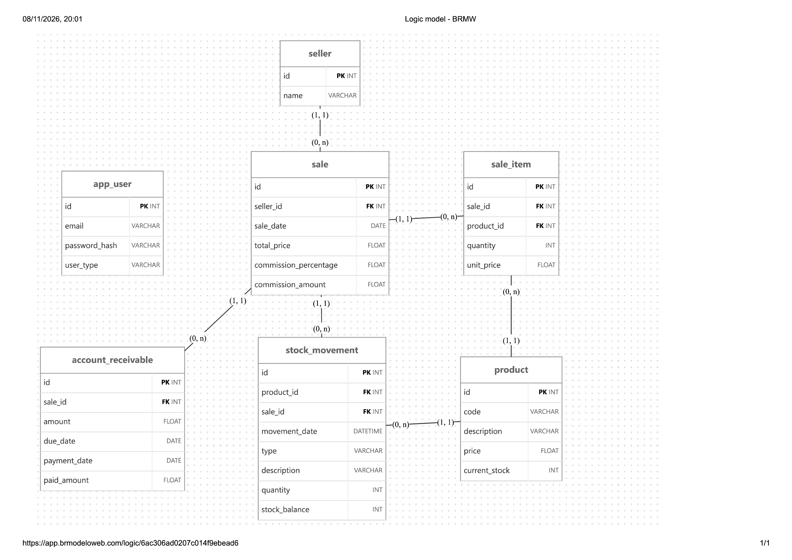
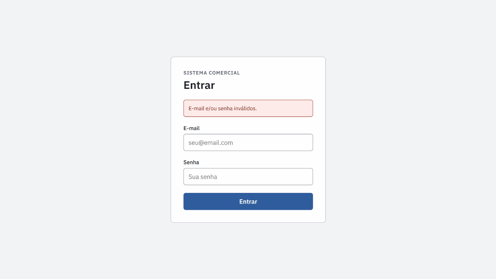
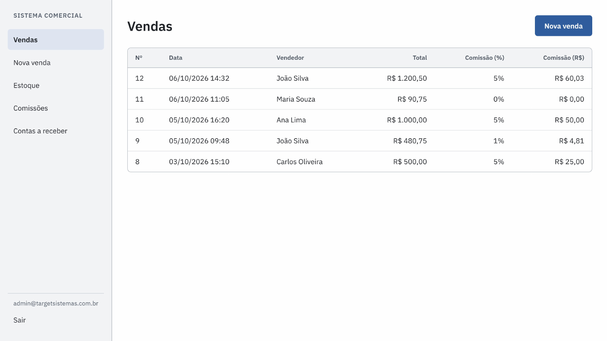
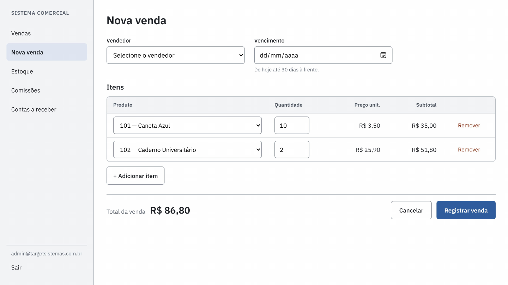
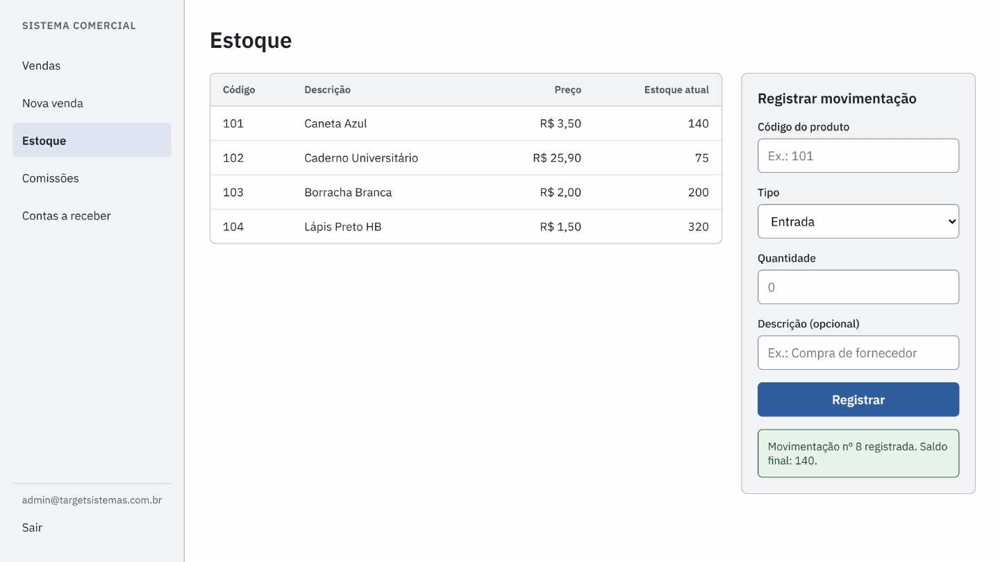
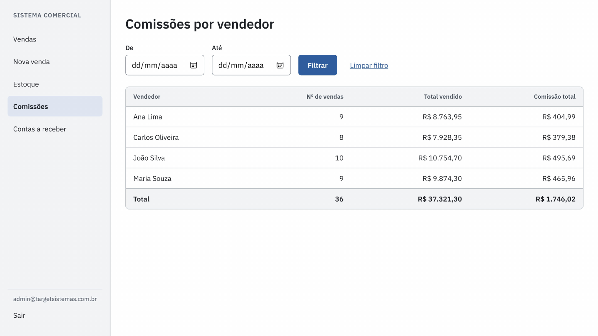
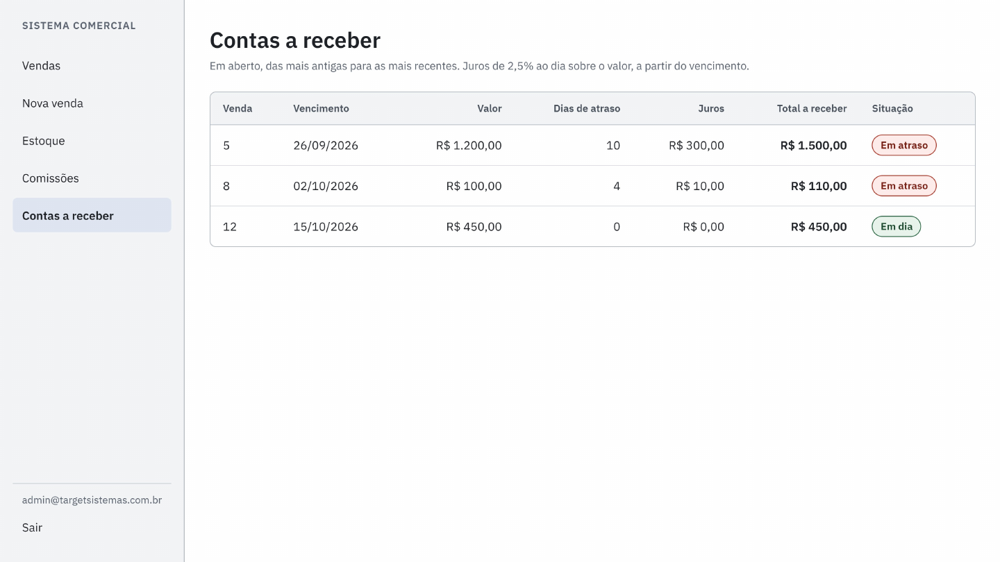

<p align="center">
  
</p>

<h1 align="center">Desafio Target Sistemas</h1>

<p align="center">
  Um mini sistema comercial que integra os três exercícios do desafio técnico — comissão, estoque e juros — num só produto, com API, banco e front-end.
</p>

<p align="center">
  
  
  
  
  <a href="https://sonarcloud.io/summary/new_code?id=Will-Ribeiro00_DesafioTargetSistemas">
    
  </a>
  <a href="https://sonarcloud.io/summary/new_code?id=Will-Ribeiro00_DesafioTargetSistemas">
    
  </a>
  <a href="https://github.com/Will-Ribeiro00/DesafioTargetSistemas/actions/workflows/tests.yml">
    
  </a>
</p>

<p align="center">
  <a href="https://will-ribeiro00.github.io/DesafioTargetSistemas/"><strong>Acessar o sistema</strong></a> ·
  <a href="#telas-wireframe">Ver as telas</a> ·
  <a href="#como-rodar-localmente">Rodar localmente</a> ·
  <a href="especificacoes/">Especificações</a>
</p>

---

## Sistema publicado

| | Endereço |
|---|---|
| **Front-end** (GitHub Pages) | https://will-ribeiro00.github.io/DesafioTargetSistemas/ |
| **API** (Azure App Service) | https://desafio-target-sistemas-gqhzb5ggc2dccwa5.centralus-01.azurewebsites.net/api/hml |

As credenciais de acesso foram enviadas junto com o link deste repositório.

> **Primeiro acesso pode demorar.** A API e o banco estão em planos gratuitos do Azure, que pausam depois de um período sem uso. A primeira requisição os "acorda": a API espera até 60 segundos pelo banco, mas, nos piores casos, a resposta ainda pode falhar. Se isso acontecer, aguarde cerca de um minuto e tente de novo.

---

## Sumário

- [O desafio original](#o-desafio-original)
- [Como os três temas se conectam](#como-os-três-temas-se-conectam)
- [Estrutura do repositório](#estrutura-do-repositório)
- [Modelo de dados](#modelo-de-dados)
- [Arquitetura do back-end](#arquitetura-do-back-end)
- [Concorrência no estoque](#concorrência-no-estoque)
- [Autenticação](#autenticação)
- [Internacionalização](#internacionalização)
- [Tratamento de erros](#tratamento-de-erros)
- [Observabilidade e resiliência](#observabilidade-e-resiliência)
- [Endpoints](#endpoints)
- [Front-end](#front-end)
- [Telas (wireframe)](#telas-wireframe)
- [Testes](#testes)
- [Integração contínua e qualidade](#integração-contínua-e-qualidade)
- [Banco de dados: scripts](#banco-de-dados-scripts)
- [Como rodar localmente](#como-rodar-localmente)
- [Deploy](#deploy)
- [Decisões de negócios e melhorias além do pedido original](#decisões-de-negócios-e-melhorias-além-do-pedido-original)
- [Fora do escopo](#fora-do-escopo)

---

## O desafio original

O desafio ([`especificacoes/desafio_dev.docx`](especificacoes/desafio_dev.docx)) trazia três exercícios independentes:

1. **Comissão de vendas.** Dado um JSON com vendas (`vendedor`, `valor`), calcular a comissão de cada vendedor: menos de R$ 100 não gera comissão, de R$ 100 a R$ 499,99 gera 1%, a partir de R$ 500 gera 5%.
2. **Movimentação de estoque.** Dado um JSON de produtos (`codigoProduto`, `descricaoProduto`, `estoque`), permitir lançar entradas e saídas, cada uma com um identificador único e uma descrição, devolvendo a quantidade final do estoque movimentado.
3. **Juros por atraso.** A partir de um valor e uma data de vencimento, calcular o juro do dia de hoje, à taxa de 2,5% ao dia.

Cada um, isoladamente, poderia ser um script de console. A decisão deste projeto foi tratá-los como **três regras de negócio de um mesmo sistema comercial**: um admin que faz login, consulta vendas, estoque, comissões e contas a receber, registra novas vendas e movimentações, e dá baixa nos pagamentos.

## Como os três temas se conectam

| Tema do desafio | Onde vive no sistema |
|---|---|
| Comissão | Calculada e **gravada** no momento da venda (`sale.commission_percentage`, `sale.commission_amount`), para não mudar retroativamente se a regra evoluir |
| Estoque | Cada item de uma venda gera uma **saída** de estoque (`stock_movement`, `type = OUT`) vinculada àquela venda. Entradas avulsas (compra de fornecedor, ajuste) passam pela mesma tabela, sem vínculo com venda |
| Juros | Toda venda gera uma **conta a receber** (`account_receivable`) com data de vencimento. Enquanto a conta está em aberto, o juro é calculado **na consulta**, a partir do vencimento e da data de hoje. Na **baixa**, o valor efetivamente pago (original + juros do dia) é gravado |

Registrar uma venda, portanto, é uma única transação que cria a venda, os itens, a comissão, as saídas de estoque e a conta a receber — tudo ou nada.

## Estrutura do repositório

```
DesafioTargetSistemas/
├── .github/workflows/         testes e análise do SonarCloud a cada push (tests.yml) e publicação do front (static.yml)
├── especificacoes/            desafio, modelo do banco, scripts SQL e wireframe
├── src/
│   ├── backend/               API em .NET 10 (DDD, 6 projetos)
│   ├── frontend/              HTML, CSS e JavaScript
│   └── tests/                 4 projetos de teste (xUnit)
└── DesafioTargetSistemas.slnx
```

## Modelo de dados

<p align="center">
  <a href="especificacoes/Banco/modelo_logico.pdf">
    
  </a>
</p>

<p align="center"><sub>Clique na imagem para abrir o PDF original (brModelo).</sub></p>

O modelo lógico foi desenhado antes do código. No banco físico, os tipos ficaram mais precisos do que no diagrama: valores em dinheiro como `DECIMAL(18,2)` (e não `FLOAT`, que acumula erro de arredondamento), datas de venda e de movimentação com hora (`DATETIME2`), e constraints de `UNIQUE` e `CHECK` que o diagrama não representa. O script completo está em [`query_base.sql`](especificacoes/Banco/query_base.sql).

Decisões de modelagem que valem registrar:

- **`app_user` é independente do resto.** Só serve para login.
- **`seller` (vendedor) não loga**, é cadastro de negócio. Separá-lo do usuário do sistema evitou acoplar autenticação a uma entidade que não precisa dela.
- **`stock_movement.sale_id` é opcional**, e uma `CHECK` constraint garante que uma entrada (`IN`) nunca tem venda associada. Só a saída (`OUT`) pode ter, e mesmo assim não é obrigatório: uma perda ou ajuste de inventário também é uma saída, sem venda.
- **Comissão, preço e valor pago são snapshot.** `sale.commission_percentage`, `sale.commission_amount`, `sale_item.unit_price` e `account_receivable.paid_amount` gravam o valor **do momento** da venda ou do pagamento. Se o preço do produto, a regra de comissão ou a taxa de juros mudarem depois, o histórico continua correto.
- **Juros de contas em aberto não têm coluna.** Eles dependem de "hoje", então um valor gravado estaria desatualizado no dia seguinte. A API calcula na hora de responder, e só grava o resultado na baixa, dentro do `paid_amount`.
- **Data e valor de pagamento andam juntos.** Uma `CHECK` constraint garante que `payment_date` e `paid_amount` estão os dois vazios (conta em aberto) ou os dois preenchidos (conta paga).
- **Estoque negativo é barrado no próprio banco** (`CHECK current_stock >= 0`), além da validação da API.
- **`product.row_version`** (`rowversion`) é um mecanismo técnico para detectar gravações simultâneas no mesmo produto (veja [Concorrência no estoque](#concorrência-no-estoque)). Por não ser um dado do negócio, ele fica fora do diagrama, como os índices e as constraints.
- **Nomes em inglês no banco, mensagens em português para o usuário.** `product`, `code` e `type IN/OUT` seguem o padrão técnico; as mensagens de erro (`.resx`) são traduzidas.

## Arquitetura do back-end

Camadas, no estilo DDD, com SOLID e injeção de dependência:

```
Api            → Controllers finos, filtros de exceção e de autenticação, configuração do hospedeiro
Application    → Casos de uso (UseCases), validadores (FluentValidation) e nova tentativa em conflitos
Domain         → Entidades, interfaces de repositório, regras de negócio puras
Infrastructure → EF Core, repositórios, unidade de trabalho, geração/validação de token, DI
Communication  → Requests e Responses (contratos JSON da API)
Exception      → Hierarquia de exceções de negócio e mensagens (.resx)
```

Regra de dependência: `Api → Application → Domain`, e `Infrastructure → Domain`. O `Domain` não conhece banco, HTTP nem bibliotecas externas: guarda entidades, interfaces e regras. Configurações do hospedeiro, como CORS e observabilidade, ficam no `Program.cs` (o *composition root*), porque nenhuma regra de negócio depende delas.

**Regras de negócio puras, testáveis sem banco:**

- `CommissionCalculator`: as três faixas de comissão do desafio.
- `InterestCalculator`: os 2,5% ao dia, juros simples sobre o valor em aberto. Ele recebe a data de referência por parâmetro, em vez de ler o relógio, o que permite testá-lo com datas fixas.

Cada caso de uso segue o mesmo formato: valida o request (FluentValidation), busca o que precisa nos repositórios, aplica a regra, grava tudo num único `UnitOfWork.Commit()` quando há escrita, e devolve um Response enxuto — só o que o servidor gerou ou decidiu, nunca a entidade crua.

## Concorrência no estoque

Duas operações gravando o mesmo produto ao mesmo tempo poderiam sobrescrever uma à outra: as duas leem o mesmo estoque, as duas conferem que ele é suficiente, e a segunda gravação apaga a primeira (a "atualização perdida"). O `CHECK` de estoque negativo não pega esse caso, porque cada gravação, sozinha, é válida.

A solução é **concorrência otimista com nova tentativa**:

1. **O produto tem uma versão** (`row_version`), que o SQL Server muda sozinho a cada alteração. No EF Core, ela é um token de concorrência: todo `UPDATE` de produto só acontece se a versão ainda for a mesma da leitura.
2. **O conflito é traduzido.** Quando a versão mudou, o EF lança um `DbUpdateConcurrencyException`. O `UnitOfWork` (Infrastructure) o converte num `ConcurrencyConflictException` do projeto, para a Application não depender do EF.
3. **O `ConcurrencyRetry` tenta de novo** (Application). Ele recebe a operação como um delegate e a executa até 3 vezes. Entre uma tentativa e outra, limpa a memória do EF (`Discard`), para a próxima ler o estoque atual do banco. Só se o conflito persistir o usuário recebe um `409`.

Vale para o registro de venda e para a movimentação de estoque. A alternativa, uma atualização atômica condicional no banco, foi descartada porque não funciona no banco em memória usado pelos testes de integração.

## Autenticação

- **Login:** `POST /login` recebe e-mail e senha, confere o hash com **BCrypt** (a senha nunca é gravada em texto puro; o hash do admin é gerado por um script à parte, já que não há endpoint de cadastro de usuário) e devolve um **JWT**.
- **Validação do token:** feita por um filtro de autorização próprio (`AuthenticatedRequestFilter` + atributo `[AuthenticatedUser]`), que verifica assinatura e expiração e devolve as respostas no mesmo formato de erro do resto da API, inclusive um sinalizador `tokenIsExpired` para o front saber quando pedir login de novo.
- Todo controller que precisa de login herda de uma base com `[AuthenticatedUser]`. O de login fica de fora, porque quem ainda não entrou não tem token.

## Internacionalização

As mensagens de erro vêm de arquivos de recurso (`.resx`), com inglês como idioma padrão e tradução para `pt-BR`. Um middleware próprio (`CultureMiddleware`) lê o header `Accept-Language` da requisição, respeitando a prioridade declarada pelo cliente (`q=`), e define a cultura antes do controller rodar. O front-end sempre envia `Accept-Language: pt-BR`.

Para adicionar um novo idioma, basta criar, no projeto `Exception`, um arquivo `ResourceMessageException.<cultura>.resx` com as mesmas chaves do arquivo padrão (ex.: `ResourceMessageException.es.resx` para espanhol) e incluir a cultura em `Settings:Localization:SupportedCultures` no `appsettings.json` (ou nas variáveis de ambiente, em produção).

## Tratamento de erros

Toda exceção de negócio herda de uma base comum (`DesafioTargetSistemasException`), que carrega a lista de mensagens e o status HTTP correspondente. Um `ExceptionFilter` converte isso numa resposta padronizada:

```json
{ "errors": ["Estoque insuficiente para esta saída."] }
```

| Status | Quando |
|---|---|
| `400` | Erros de validação (que podem vir vários de uma vez), estoque insuficiente e requisições malformadas (JSON inválido, tipo errado, enum inexistente) |
| `401` | Token ausente, inválido ou expirado, e login com e-mail ou senha inválidos |
| `404` | Vendedor, produto ou conta a receber inexistente |
| `409` | Conta a receber já paga, ou conflito de concorrência que persistiu depois das novas tentativas |
| `500` | Qualquer exceção não prevista, com uma mensagem genérica, sem expor detalhes internos a quem chamou a API. O erro completo é registrado no log (veja [Observabilidade](#observabilidade-e-resiliência)) |

## Observabilidade e resiliência

**Log de erros.** Os erros inesperados são registrados no `ExceptionFilter` com o `ILogger` do .NET, em **log estruturado**: a mensagem é um modelo (`"Unhandled exception on {Method} {Path}"`), e o método HTTP e a rota ficam guardados como campos separados, pesquisáveis.

**Application Insights via OpenTelemetry.** Em produção, a API envia os logs, as requisições (rota, status e duração) e as exceções para o **Application Insights**, pela distribuição de OpenTelemetry da Microsoft (`Azure.Monitor.OpenTelemetry.AspNetCore`). Lá os dados ficam persistidos, com a requisição que causou cada erro, painéis de falhas e desempenho, e consultas em KQL. O código só conhece o `ILogger`: trocar o destino (Datadog, Grafana...) não exige mudar quem escreve o log. O envio só é ligado quando existe a variável `APPLICATIONINSIGHTS_CONNECTION_STRING`, então a máquina local, os testes e o GitHub Actions não são afetados.

**Resiliência na conexão com o banco.** O EF Core repete automaticamente as operações que falham por erros temporários de conexão (`EnableRetryOnFailure`). Ele não repete timeouts (um timeout também pode ser uma consulta pesada), e por isso o tempo limite de conexão foi ampliado para 60 segundos, que é o caso típico do banco gratuito acordando da pausa.

## Endpoints

Prefixo: `/api/hml`

| Método | Rota | Autenticado | O que faz |
|---|---|---|---|
| `POST` | `/login` | não | Autentica e devolve o token |
| `GET` | `/sellers` | sim | Lista vendedores |
| `GET` | `/sellers/commissions?from=&to=` | sim | Total vendido e comissão por vendedor, com filtro de período opcional |
| `GET` | `/products` | sim | Lista produtos com estoque atual |
| `POST` | `/stockmovements` | sim | Registra entrada ou saída de estoque e devolve o identificador e o saldo final |
| `POST` | `/sales` | sim | Registra uma venda completa (itens, comissão, baixa de estoque, conta a receber) |
| `GET` | `/sales` | sim | Lista vendas, com vendedor e comissão |
| `GET` | `/accountsreceivable/open` | sim | Lista contas em aberto, com dias de atraso, juros e total a receber até hoje |
| `GET` | `/accountsreceivable/paid` | sim | Lista contas pagas, com a data do pagamento, o atraso até o pagamento, os juros pagos e o valor pago |
| `PATCH` | `/accountsreceivable/{id}/payment` | sim | Dá baixa numa conta com a data de hoje e grava o valor pago (original + juros do dia) |

Em ambiente de desenvolvimento, a documentação interativa da API (OpenAPI + Scalar) fica disponível em `/scalar`.

## Front-end

HTML, CSS e JavaScript puro — sem framework e sem bundler —, para manter o projeto simples e focado no desafio. JavaScript em **módulos ES** (`import`/`export`), organizado por responsabilidade:

```
frontend/
├── index.html                 tela de login
├── pags/                      as outras telas (uma página HTML cada)
│   ├── vendas.html
│   ├── nova-venda.html
│   ├── estoque.html
│   ├── comissoes.html
│   └── contas-a-receber.html
├── css/                       estilos (base, layout, componentes e um arquivo por tela)
└── js/
    ├── config.js              endereço da API e constantes
    ├── services/
    │   ├── api.js             fetch central: token, idioma, tratamento de erro
    │   └── auth.js            guarda/lê o token, protege páginas
    ├── utils/
    │   └── format.js          formatação de dinheiro, datas, texto seguro
    ├── components/
    │   ├── alert.js           caixa de erro/sucesso
    │   └── sidebar.js         menu lateral
    └── pages/                 um arquivo js por tela
        ├── login.js
        ├── vendas.js
        ├── nova-venda.js
        ├── estoque.js
        ├── comissoes.js
        └── contas-a-receber.js
```

- **Sessão:** o token fica no `localStorage`. Uma resposta `401` limpa o token e volta para o login, distinguindo expiração de token inválido, e uma página protegida não reaparece pelo botão "Voltar" depois do logout.
- **Confirmação nas ações sem volta:** registrar uma venda, registrar uma movimentação e dar baixa numa conta abrem uma janela de confirmação com o resumo do que vai ser gravado. A janela usa o `<dialog>` nativo do HTML (fundo escurecido, tecla Esc e foco preso dentro dela sem código extra), com o mesmo componente visual nas três telas. Ela avisa que os valores finais (total, comissão, saldo, valor pago) são calculados pelo servidor.
- **Validação antes da confirmação:** as telas conferem os campos antes de abrir a janela e mostram **todos** os erros de uma vez, como a API faz. A nova venda também recusa produtos repetidos, listando todos eles. A validação da API continua sendo a garantia: a do front existe para o usuário descobrir o problema antes.
- **Contas a receber em duas visões:** um controle segmentado alterna entre "Em aberto" (com o botão de baixa) e "Pagas". O botão ativo é marcado com `aria-pressed`, que também define o destaque visual.

## Telas (wireframe)

As telas foram desenhadas antes do front-end, como guia de layout ([PDF completo](especificacoes/wireframe/Wireframe%20-%20Sistema%20Comercial%20%28Admin%29.pdf)). A interface final segue o mesmo desenho, e foi além dele nas janelas de confirmação e nas visões "Em aberto" e "Pagas" de contas a receber. Os valores das imagens são de exemplo.

<table>
  <tr>
    <td align="center" width="50%">
      <a href="especificacoes/wireframe/1-login.png"></a>
      <br><sub><b>Login</b> — mensagem genérica para e-mail ou senha inválidos</sub>
    </td>
    <td align="center" width="50%">
      <a href="especificacoes/wireframe/2-vendas.png"></a>
      <br><sub><b>Vendas</b> — data, vendedor, total e comissão de cada venda</sub>
    </td>
  </tr>
  <tr>
    <td align="center">
      <a href="especificacoes/wireframe/3-nova-venda.png"></a>
      <br><sub><b>Nova venda</b> — itens, total em tempo real e vencimento em até 30 dias</sub>
    </td>
    <td align="center">
      <a href="especificacoes/wireframe/4-estoque.png"></a>
      <br><sub><b>Estoque</b> — saldo atual e registro de entradas e saídas</sub>
    </td>
  </tr>
  <tr>
    <td align="center">
      <a href="especificacoes/wireframe/5-comissoes.png"></a>
      <br><sub><b>Comissões</b> — total vendido e comissão por vendedor, com filtro de período</sub>
    </td>
    <td align="center">
      <a href="especificacoes/wireframe/6-contas-a-receber.png"></a>
      <br><sub><b>Contas a receber</b> — dias de atraso, juros e total a receber</sub>
    </td>
  </tr>
</table>

## Testes

São **170 testes**, em três projetos de teste e uma biblioteca compartilhada, com xUnit, Shouldly, Moq e Bogus:

| Projeto | Testes | O que cobre |
|---|---|---|
| `Validator.Test` | 34 | Cada regra de cada validador, incluindo as bordas (o último dia aceito de vencimento, o tamanho máximo do código) |
| `UseCase.Test` | 59 | Os casos de uso com repositórios falsos (Moq), os calculadores de comissão e de juros (incluindo o total de comissão do João Silva no JSON do desafio, R$ 495,69), o `ConcurrencyRetry` e a nova tentativa dentro dos casos de uso de venda e de estoque |
| `WebApi.Test` | 77 | A API inteira, de ponta a ponta: sobe a aplicação com um banco em memória, chama cada rota por HTTP, confere status, respostas e o que ficou gravado, verifica as mensagens de erro nos dois idiomas e testa o token em todas as rotas protegidas |
| `CommonTestUtilities` | — | Os builders de requests e entidades (com dados aleatórios do Bogus) e os repositórios falsos, compartilhados pelos projetos de teste |

Os testes de API usam uma `WebApplicationFactory` que troca o SQL Server por um banco em memória, popula os dados de teste e gera tokens com o gerador da própria API. Eles rodam no ambiente `Test`, com o `appsettings.Test.json`, e não precisam de banco nem de configuração local.

A cobertura é medida a cada execução do workflow, com o `coverlet`, e aparece no SonarCloud (o selo **Coverage**, no topo).

Para rodar, na raiz do repositório:

```
dotnet test
```

## Integração contínua e qualidade

- **Testes e análise a cada push:** o workflow [`tests.yml`](.github/workflows/tests.yml) compila a solução, roda todos os testes com cobertura e envia a análise ao SonarCloud a cada push e pull request na `master`. Commits que mexem só nas especificações ou em arquivos `.md` não disparam o workflow.
- **Publicação do front:** o workflow [`static.yml`](.github/workflows/static.yml) publica a pasta `src/frontend` no GitHub Pages a cada push.
- **Análise de código:** o SonarCloud analisa o código de `src` a cada execução do workflow, incluindo a cobertura dos testes do back-end, e aplica um Quality Gate. O front-end entra na análise de qualidade, mas fica fora do cálculo de cobertura, porque não tem testes automatizados.
- **Dependências:** os pacotes estão atualizados dentro da família do .NET 10, sem vulnerabilidades conhecidas (`dotnet list package --vulnerable --include-transitive`).

## Banco de dados: scripts

Todos em [`especificacoes/Banco/`](especificacoes/Banco/):

| Arquivo | Para que serve |
|---|---|
| `query_base.sql` | Cria a estrutura (tabelas, constraints, índices), sem dados |
| `seed_desafio.sql` | Limpa os dados e popula o banco com os dois JSONs do desafio (vendedores, vendas, produtos, estoque inicial), com os vínculos de itens, movimentações de estoque e contas a receber, incluindo contas em aberto, vencidas e pagas (com o valor pago) para demonstração. Não altera o usuário de login |
| `espelho_banco.xlsx` | Retrato dos dados do banco criado no Azure SQL Database; não reflete o banco local |
| `modelo_logico.pdf` | Modelo lógico do banco (brModelo) |

## Como rodar localmente

**Banco:** crie um Azure SQL Database (ou um SQL Server local) e rode `query_base.sql`, depois `seed_desafio.sql`. O usuário de login é inserido à parte em `app_user`, com a senha já em hash BCrypt.

**API:**
1. Configure a connection string e a chave de assinatura do JWT em `appsettings.Development.json` (fora do controle de versão).
2. `dotnet run` no projeto `DesafioTargetSistemas.API`.
3. Libere o CORS (`AddCors`/`UseCors` em `Program.cs`) para a origem onde o front vai rodar.

Localmente, o envio para o Application Insights fica desligado, porque a variável `APPLICATIONINSIGHTS_CONNECTION_STRING` não existe. Os logs aparecem na janela de saída do Visual Studio.

**Front-end:**
1. Em `js/config.js`, aponte `API_URL` para o endereço da API local.
2. Sirva a pasta com um servidor local (ex.: Live Server do VS Code). Módulos ES não funcionam abrindo o arquivo direto no navegador (`file://`).

**Testes:** `dotnet test` na raiz do repositório. Eles não dependem do banco nem do `appsettings.Development.json`.

## Deploy

- **Banco:** Azure SQL Database. Mudanças de estrutura (como colunas novas) são aplicadas no banco **antes** de publicar a versão da API que as usa.
- **API:** Azure App Service. Segredos e configurações ficam nas variáveis de ambiente do portal, nunca no repositório: a connection string, a chave do JWT e a connection string do Application Insights.
- **Front-end:** GitHub Pages, publicado pelo GitHub Actions, com `config.js` apontando para a URL pública da API e a origem do Pages liberada no CORS da API.

## Decisões de negócios e melhorias além do pedido original

O desafio não pedia nada disto, mas foi incorporado por fazer sentido num sistema real:

- **O próprio formato do projeto.** Em vez de três scripts isolados, os três exercícios viraram um mini sistema comercial completo, com banco, API, autenticação e interface, em que comissão, estoque e juros são consequências de um mesmo evento: a venda.
- **Baixa de pagamento.** O exercício de juros fecha o ciclo: a conta a receber pode ser paga, e o valor pago (com os juros do dia) fica gravado. Uma conta já paga não pode ser paga de novo (`409`).
- **Contas pagas na mesma tela das contas a receber.** Seguindo a forma como os ERPs organizam o módulo, uma conta paga continua sendo uma conta a receber, só que baixada. Os juros mostrados nas pagas são os que foram realmente pagos, e não recalculados.
- **Vencimento de venda não pode ser retroativo, nem passar de 30 dias à frente**, validado no front e na API.
- **E-mail ou senha inválidos devolvem a mesma mensagem genérica**, para não revelar quais e-mails estão cadastrados.
- **Mensagens de erro em dois idiomas** (inglês e português), escolhidas pelo header `Accept-Language`.
- **Confirmação antes de toda ação sem volta**, já que não existe cancelamento de venda, de movimentação ou de baixa.
- **Concorrência otimista no estoque**, para duas vendas simultâneas do mesmo produto não corromperem o saldo.
- **Índice parcial** em `account_receivable` (só contas em aberto), já que é a consulta mais frequente dessa tabela.
- **`stock_movement` nasce pensando em dois tipos de lançamento**: o automático, gerado pela venda, e o manual (compra, ajuste), registrado pela tela de estoque.

## Fora do escopo

Para manter o projeto do tamanho de um desafio técnico, ficaram de fora: cadastro de usuário, vendedor e produto pela interface (hoje via seed/SQL direto), escolha da data da baixa (hoje ela é sempre a data do dia, em UTC), estorno de baixa e cancelamento de venda ou de movimentação, paginação nas listagens, renovação de token (refresh token), cancelamento de token antes da expiração e publicação da API pelo GitHub Actions (hoje feita pelo Visual Studio).

---

<p align="center">
  Desenvolvido por <strong>Williansberg Ribeiro da Silva</strong> como desafio técnico para o processo seletivo da <strong>Target Sistemas</strong>.
</p>

<p align="center">
  <a href="https://www.linkedin.com/in/williansberg-ribeiro-perfil/?isSelfProfile=true">LinkedIn</a> ·
  <a href="https://github.com/Will-Ribeiro00">GitHub</a> ·
  <a href="mailto:william.ribeiro1403@gmail.com">E-mail</a>
</p>

<p align="center"><sub>2026</sub></p>
